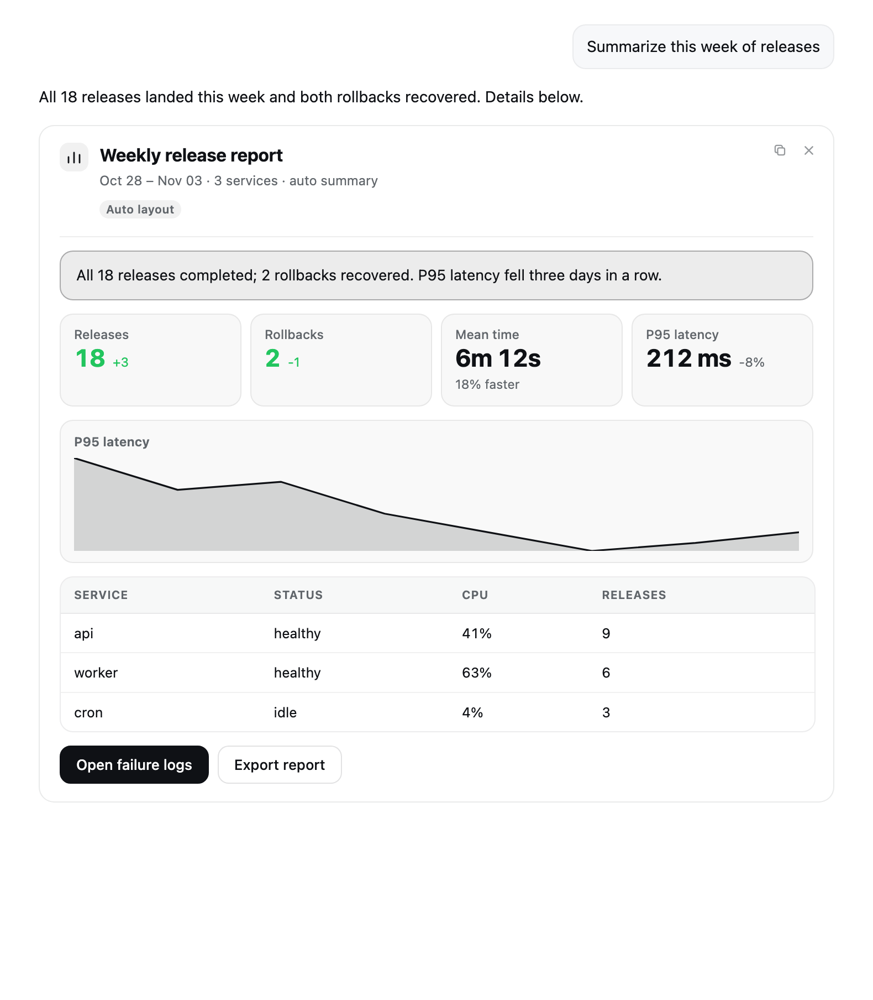
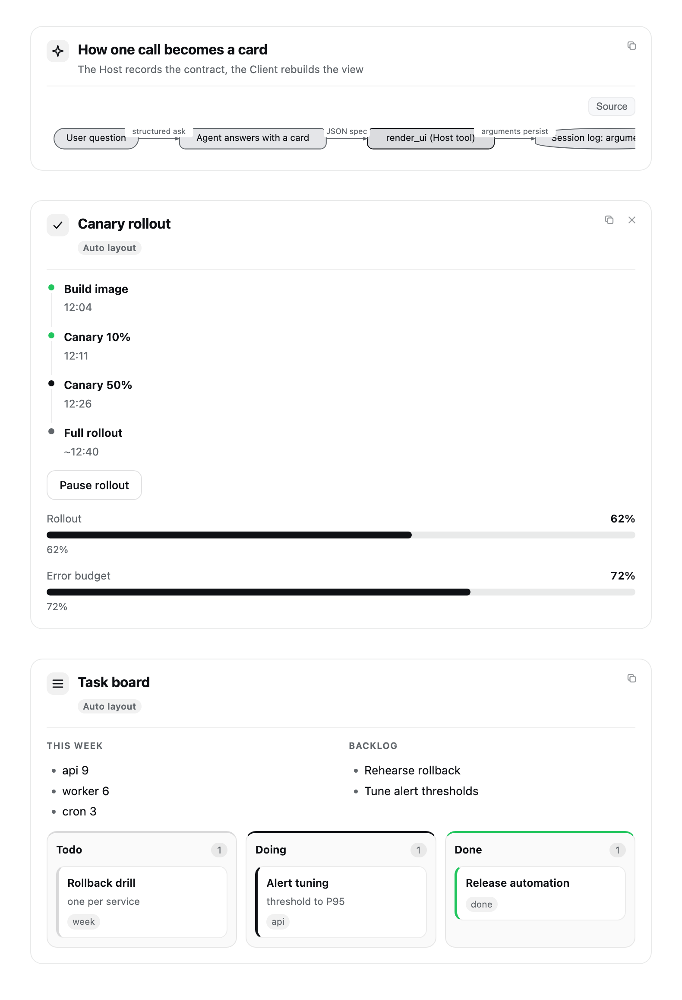
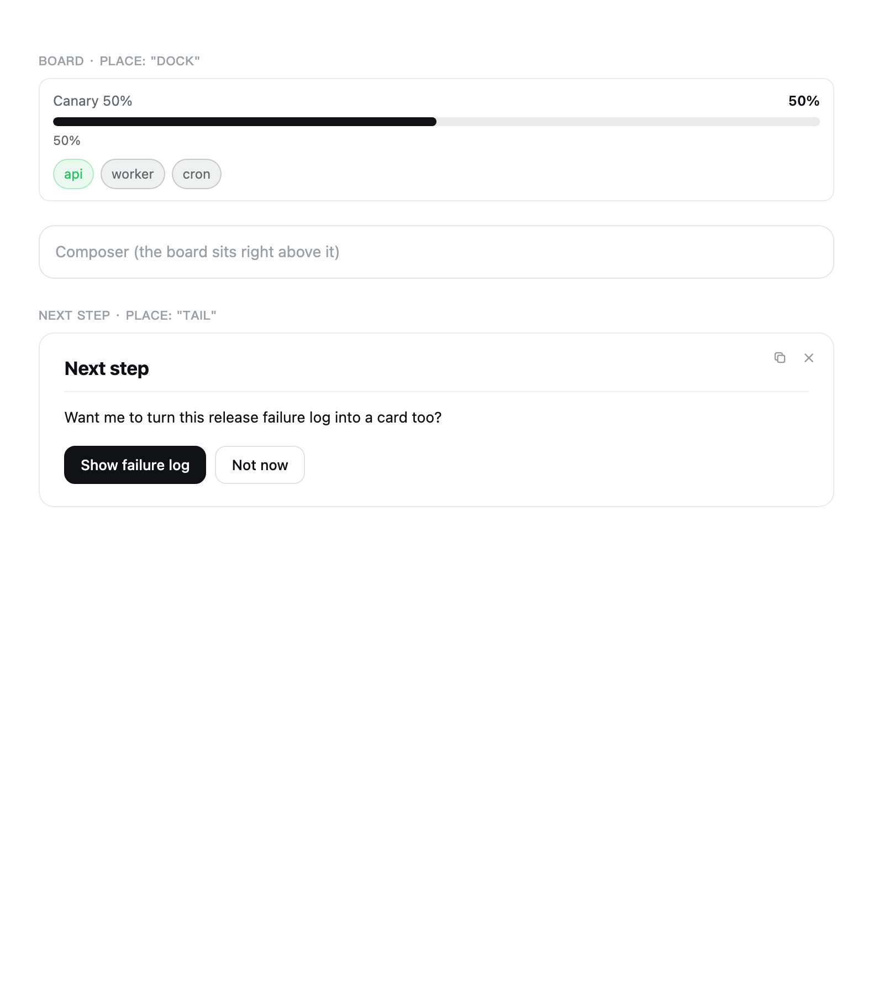

# Super Cards (dsh-super-cards)

[](LICENSE)
[](https://github.com/baitouwuya/dsh-super-cards/actions/workflows/ci.yml)
[](https://www.npmjs.com/package/dsh-super-cards)


**English** · [简体中文](README.md)

A DeepSeek Harness (DSH) Web plugin that lets the assistant answer structured questions with
**native UI cards instead of Markdown**. When the model faces a comparison, metrics, a table, a
chart, steps, or a decision, it calls the `render_ui` tool and the answer renders as a card in the
conversation flow: metric grids, trend lines, tables, timelines, kanban boards, flow charts, and
clickable next-step buttons. Card content comes entirely from the tool-call arguments recorded in
the session log, so it survives refreshes, replays, and forks.



## What it can do

- **29 block types.** Text, heading, callout, stats, table, key-value, list, badges, progress, bars,
  sparkline, pie, code, quote, timeline, links, action buttons, divider, live counter, setting
  controls, diagram/UML, tree, heatmap, diff, kanban, tabs, columns, image, and custom HTML. A
  `content` field may replace `blocks`: name only the material and the card picks its own controls
  and layout (2–3 sections side by side, 4–5 sections as tabs). See the
  [block reference](docs/en/blocks.md) and [auto layout](docs/en/content.md).
- **Four placements.** Inline in the answer (`answer`), the folded process area (`process`), a board
  pinned above the composer (`dock`), and a next-step card at the end of the turn (`tail`). See
  [placements](docs/en/placements.md).
- **Native configuration.** Configuration is a Host Schemastery `Config` projection: four basic
  fields on the Plugins page, the full form on the Settings tab, or the profile's
  `cordis.patch.yml`. See [configuration](docs/en/configuration.md).
- **Optional automatic "next steps" card.** After a turn ends, a small model call generates a
  one-line recap, a question, and 2–4 clickable options. Off by default. See
  [next steps](docs/en/next-steps.md).
- **Progressive disclosure.** The `render_ui` description carries only a compact block directory;
  when the model needs the exact fields of one block it calls `render_ui_blocks` on demand, so the
  schema for 29 blocks never sits in context.

## Quick start

Published on npm as `dsh-super-cards`, with zero runtime dependencies:

```bash
# CLI (the profile name is the one you use; the desktop app's is desktop)
dsh plugin --profile desktop add dsh-super-cards
```

You can also click Add plugin on the Plugins page and paste the package name, or point
`plugin_manager`'s `install_bundle` at this checkout (development or offline install). Restart DSH
(or reload the plugin row) and refresh the page.

You can also install it from the plugin market: Settings → Plugin market → add the index source
`https://raw.githubusercontent.com/baitouwuya/dsh-super-cards/main/market/index.json`, then search for `dsh-super-cards` in Discover.

Then ask the model for a card, for example:

```jsonc
// arguments of render_ui
{
  "title": "Weekly deploys",
  "content": {
    "summary": "18 deploys completed, 2 rollbacks recovered.",
    "metrics": [
      { "label": "Deploys", "value": 18, "delta": "+3", "tone": "success" },
      { "label": "Rollbacks", "value": 2, "delta": "-1", "tone": "success" }
    ],
    "actions": [{ "label": "View logs", "prompt": "Show this week's deploy logs", "tone": "primary" }]
  }
}
```

A click on an action button only puts its `prompt` into the composer (it is never sent
automatically); the user presses Enter to continue. More first-run details are in
[getting started](docs/en/getting-started.md).

## Screenshots

| More blocks | Board and next steps |
| --- | --- |
|  |  |

## Documentation

| Page | Content |
| --- | --- |
| [Getting started](docs/en/getting-started.md) | Install, first call, where the card appears |
| [Block reference](docs/en/blocks.md) | Shapes, examples and caps of the 29 block types |
| [Auto layout](docs/en/content.md) | The `content` field table and the layout rules |
| [Configuration](docs/en/configuration.md) | Three config surfaces, every field, dependency notes |
| [Placements](docs/en/placements.md) | answer / process / dock / tail and the transient rules |
| [Next steps](docs/en/next-steps.md) | The optional turn-tail card generator |
| [Advanced](docs/en/advanced.md) | HTML, motion, images, controls, copy and close |
| [Internals](docs/en/internals.md) | Host/Client halves, replay, measured performance, extension service |
| [Troubleshooting](docs/en/troubleshooting.md) | Card not showing, config not applying, and other common issues |

Design details are in [SPEC.md](SPEC.md) (behavior contract) and [ARCHITECTURE.md](ARCHITECTURE.md)
(structure and tradeoffs). The docs index is [docs/README.md](docs/README.md).

## Status

Version 0.12.3, verified on DSH 0.2.2-rc.1 (cordis 4.1.0), 244/244 tests pass (`npm test`,
including Host/Client parity cases and the documentation guard). Performance numbers and known
tradeoffs are in [internals](docs/en/internals.md).

## License

[MIT](LICENSE)
