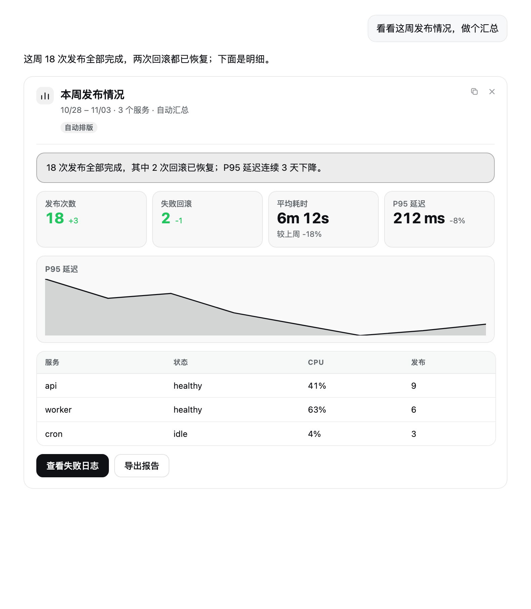
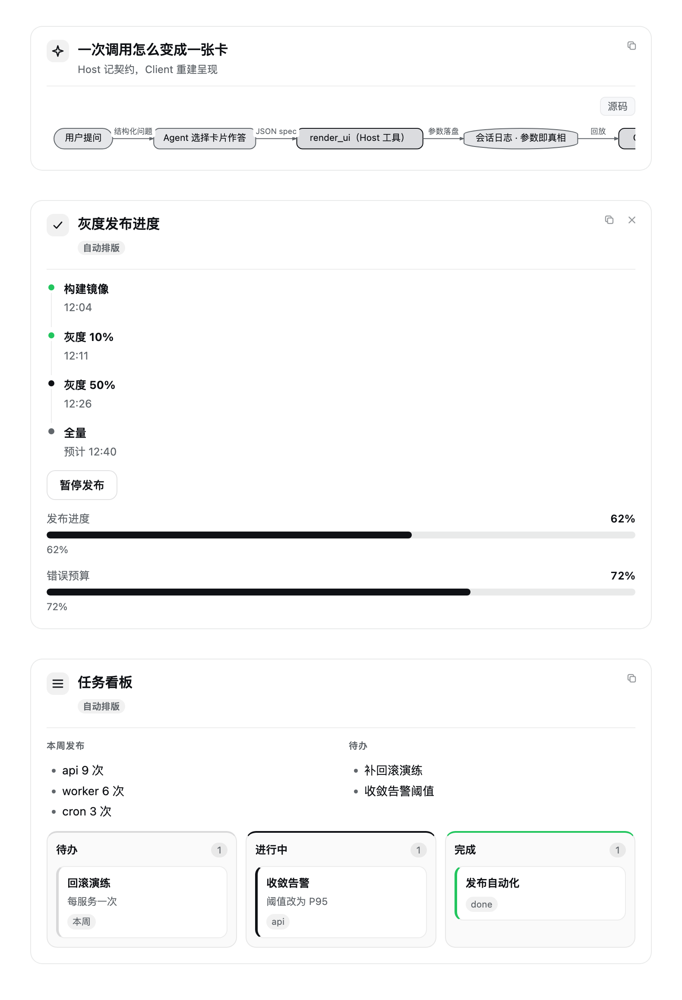
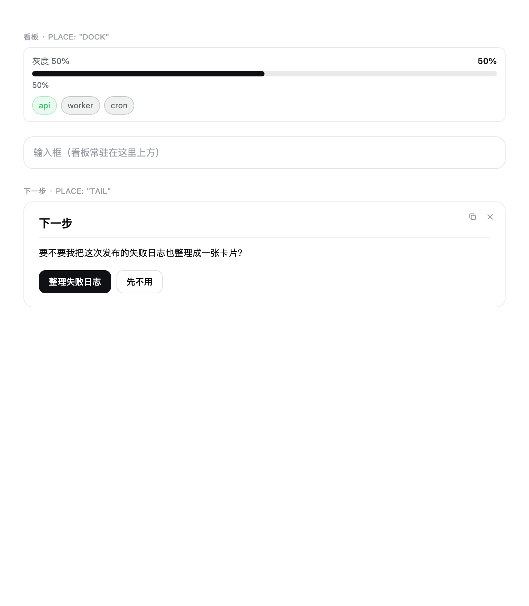

# 超级卡片（Super Cards）

[](LICENSE)
[](https://github.com/baitouwuya/dsh-super-cards/actions/workflows/ci.yml)
[](https://www.npmjs.com/package/dsh-super-cards)

**简体中文** · [English](README.en.md)

一个 DeepSeek Harness（DSH）Web 插件：让助手用**原生 UI 卡片代替 Markdown**回答结构化问题。
模型遇到对比、指标、表格、图表、步骤、方案选择这类问题时，不再输出一大段 Markdown，而是调用
`render_ui` 工具，把答案渲染成对话流里的卡片：指标网格、走势图、表格、时间线、看板、流程图、
可点击的下一步按钮。卡片内容全部来自会话日志里记录的工具调用参数，刷新、回放、fork 之后仍然存在。



## 它能做什么

- **29 种区块。** 文本、标题、提示框、指标、表格、键值、列表、标签、进度、条形图、走势图、饼图、
  代码、引用、时间线、链接、操作按钮、分隔线、实时计数、设置控件、流程图/UML、树、热力图、diff、
  看板、标签页、并排分栏、图片、自定义 HTML。完整清单见[区块参考](docs/zh/blocks.md)。
- **两种写法。** `content` 只描述材料，卡片自己挑控件、自己排版（2–3 节并排成列、4–5 节变标签页）；
  `blocks` 精确指定每个块。两者可混用，见[自动排版](docs/zh/content.md)。
- **四种落位。** 正文内联（`answer`）、过程折叠区（`process`）、输入框上方常驻看板（`dock`）、
  回合结尾的下一步卡片（`tail`），见[落位](docs/zh/placements.md)。
- **原生配置。** 配置由 Host 的 Schemastery `Config` 投影：插件页有基础四项，设置页有完整表单，
  也可以直接写 profile 的 `cordis.patch.yml`，见[配置](docs/zh/configuration.md)。
- **可选自动「下一步」卡。** 回合结束后由小模型生成一句回顾、一个问题、2–4 个可点选项；默认关闭，
  见[自动下一步](docs/zh/next-steps.md)。
- **渐进式披露。** `render_ui` 的描述只带紧凑的区块目录；模型需要某个块的精确字段时，再用
  `render_ui_blocks` 按需取回，因此不会把 29 种块的 schema 常驻进上下文。

## 快速开始

已发布到 npm，包名 `dsh-super-cards`，零运行时依赖：

```bash
# 命令行（profile 名以你的安装为准，桌面版是 desktop）
dsh plugin --profile desktop add dsh-super-cards
```

也可以在「插件」页点 Add plugin 并粘贴包名，或用 `plugin_manager` 的 `install_bundle` 指向本仓库目录
（开发/离线安装）。装好之后重启 DSH（或重载插件行）并刷新页面。

也可以在「插件市场」里直接安装：设置 → 插件市场 → 添加索引源
`https://raw.githubusercontent.com/baitouwuya/dsh-super-cards/main/market/index.json`，然后在 Discover 里搜索 `dsh-super-cards`。

然后让模型用一张卡片回答，例如：

```jsonc
// render_ui 的参数
{
  "title": "本周发布",
  "content": {
    "summary": "18 次发布全部完成，2 次回滚已恢复。",
    "metrics": [
      { "label": "发布次数", "value": 18, "delta": "+3", "tone": "success" },
      { "label": "失败回滚", "value": 2, "delta": "-1", "tone": "success" }
    ],
    "actions": [{ "label": "查看日志", "prompt": "查看本周的发布日志", "tone": "primary" }]
  }
}
```

按钮点击只是把 `prompt` 放进输入框（不会自动发送），用户按 Enter 继续追问。更多首次使用细节见
[快速开始](docs/zh/getting-started.md)。

## 截图

| 更多区块 | 看板与下一步卡 |
| --- | --- |
|  |  |

## 文档

| 页面 | 内容 |
| --- | --- |
| [快速开始](docs/zh/getting-started.md) | 安装、第一次调用、卡片出现在哪里 |
| [区块参考](docs/zh/blocks.md) | 29 种区块的形态、示例与上限 |
| [自动排版](docs/zh/content.md) | `content` 字段表与排版规则 |
| [配置](docs/zh/configuration.md) | 三个配置面、全部字段、依赖说明 |
| [落位](docs/zh/placements.md) | answer / process / dock / tail 与瞬态规则 |
| [自动下一步](docs/zh/next-steps.md) | 可选的回合尾卡生成器 |
| [进阶用法](docs/zh/advanced.md) | HTML、动效、图片、控件、复制与关闭 |
| [内部实现](docs/zh/internals.md) | Host/Client 两半、回放、性能实测、扩展服务 |
| [排错](docs/zh/troubleshooting.md) | 卡片不显示、配置不生效等常见问题 |

设计细节见 [SPEC.md](SPEC.md)（行为契约）与 [ARCHITECTURE.md](ARCHITECTURE.md)（结构与取舍）。
文档目录见 [docs/README.md](docs/README.md)。

## 状态

版本 0.14.0，在 DSH 0.2.2-rc.1（cordis 4.1.0）上实测可用，测试 253/253 通过
（`npm test`，含 Host/Client 两端一致性用例与文档一致性检查）。性能数据与已知取舍见
[内部实现](docs/zh/internals.md)。

## 许可证

[MIT](LICENSE)